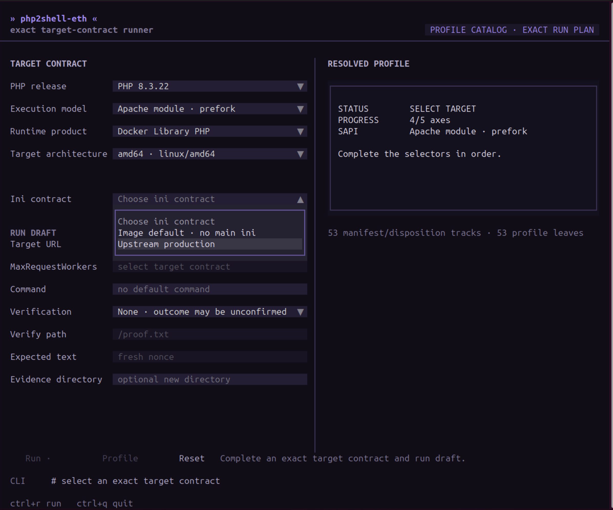

# php2shell-eth

`php2shell-eth` is a profile-driven research proof of concept for PHP
request-lifecycle vulnerabilities. Its primary interface is an interactive TUI;
the same runs can also be started from the CLI.

Use it only on systems you own or are explicitly authorized to test.

[Watch the video demo](https://youtu.be/ARz68mAv9wk)



## Install

Python 3.11 or newer is required. A virtual environment is recommended:

```sh
python3 -m venv .venv
. .venv/bin/activate
python3 -m pip install -e .
```

## TUI (recommended)

Start the program without arguments:

```sh
./php2shell-eth.py
```

Build the target contract from the selectors:

1. Choose the PHP release and execution model.
2. Choose the runtime product and **target container** architecture.
3. Choose the matching INI contract.
4. Enter the absolute target URL and command.
5. Add HTTP verification and an evidence directory when needed.

Leave `MaxRequestWorkers` empty to use the selected profile's default. Override
it only when the target Apache configuration is known to use another value.

- `Ctrl+R` runs the resolved plan and opens the live-output dialog.
- `Ctrl+Q` stops an active run and quits.
- **Copy candidate CLI** copies the exact digest-bound CLI command.
- **Reset** clears the form.

Opening and navigating the TUI sends no network traffic. The TUI resolves a
local profile contract; it does not fingerprint or attest the live target.

## CLI

Inspect the available profiles before selecting one:

```sh
./php2shell-eth.py chains
./php2shell-eth.py profiles
./php2shell-eth.py describe \
  modphp-pinned-v1/php-8.4.26-amd64-official-no-ini
```

Run one attempt with independent HTTP verification:

```sh
./php2shell-eth.py run http://target:8080/index.php \
  --profile modphp-pinned-v1/php-8.4.26-amd64-official-no-ini \
  --cmd 'printf p2s-7f31 >/var/www/html/proof.txt' \
  --verify-path /proof.txt \
  --verify-text p2s-7f31
```

This example assumes the PHP user can create the requested file under the web
root. Use a fresh marker for every run.

Recover and validate the current heap and libphp bases without dispatching B2:

```sh
./php2shell-eth.py run http://target:8080/index.php \
  --profile modphp-pinned-v1/php-8.4.26-amd64-official-no-ini \
  --cmd id \
  --leak-only \
  --evidence-dir ./evidence/run-001
```

`--cmd` remains required in leak-only mode, but the command is not dispatched.
The evidence path must be a new directory. To see chain-specific options, pass
the selected profile together with `--help`.

The TUI-generated command also includes `--profile-digest`. This binds the run
to the exact local manifest and aborts before network I/O if that manifest has
changed.

## Match the target exactly

A PHP version string alone is not enough. A profile binds the important target
properties, including:

- PHP patch release and `apache2handler`/`mpm_prefork` execution model;
- target architecture, not the computer running this client;
- Docker Library PHP versus Docker Library WordPress;
- OCI runtime bundle and libphp build identity;
- loaded extensions, INI contract and relevant effective settings;
- Apache `MaxRequestWorkers` and the stage-specific heap calibration.

**No main ini** means no loaded `php.ini`; the image's normal scanned files
under `conf.d` still apply. Removing `conf.d/*.ini`, including the standard
OPcache or sodium snippets, creates a different target and requires another
profile.

Docker tags are mutable. Use `describe` to inspect the expected image, binary,
extensions and settings. A nearby PHP release, another package build, a changed
extension set or a similar-looking WordPress image does not inherit a profile.

Current profiles require direct HTTP access to matching Apache mod_php with
`mpm_prefork` and session upload progress enabled. HTTPS termination, reverse
proxies and PHP-FPM are not interchangeable with this execution path.

## Workers

`--workers` is the target's configured `MaxRequestWorkers`; it is not client
concurrency. The scheduler holds N-1 prefork children with incomplete requests
so A1, B1, A2 and B2 reach the remaining child. A wrong value breaks worker
affinity and invalidates the run.

## Chain overview

One invocation performs a single fail-closed attempt:

1. Preflight the target and pin N-1 prefork workers.
2. A1 creates the request-lifecycle stale state.
3. B1 discloses and validates the current Zend heap and libphp bases.
4. A2 creates the calibrated execution state.
5. B2 dispatches the supplied command.
6. Release the holders and optionally verify the result with a fresh GET.

Runtime ASLR addresses come from the current B1 disclosure; they are not stored
in a profile. There are no hidden stage retries.

## Results and verification

An empty B2 response, closed connection or dead Apache child is not proof of
command execution.

- `success`: the requested proof was independently observed, or leak-only
  validation completed.
- `unconfirmed`: B2 was dispatched but no independent proof was obtained.
- `transient_miss`: a calibrated one-shot stage did not reach its required
  state, so the disturbed worker state was discarded.
- `requirement_missing` or `transport_error`: the run could not safely reach
  the chain.

When a transient miss occurs, confirm the complete target contract first. Use
a fresh lab worker/container before treating a retry as meaningful.

## Evidence

`--evidence-dir` records stage responses, B1 analysis, the optional verification
response and `run.json`. The record includes the exact profile digest, profile
status and effective worker count.

B1 evidence may contain disclosed process memory. Treat it as sensitive and
inspect it before sharing.

## Tests

```sh
python3 -m unittest discover -s tests -v
```

The profile catalog is dynamic. Use `./php2shell-eth.py profiles` for the
current runnable set rather than relying on a copied list.
